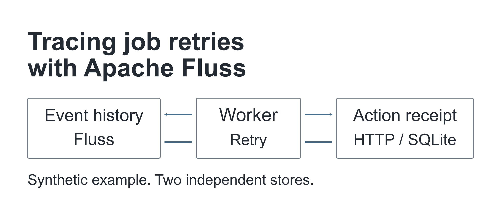
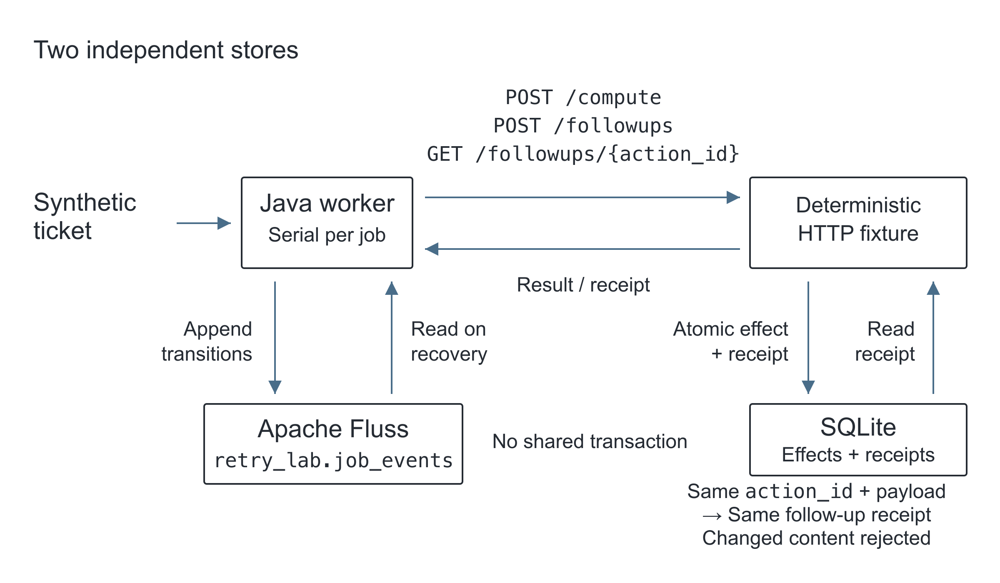
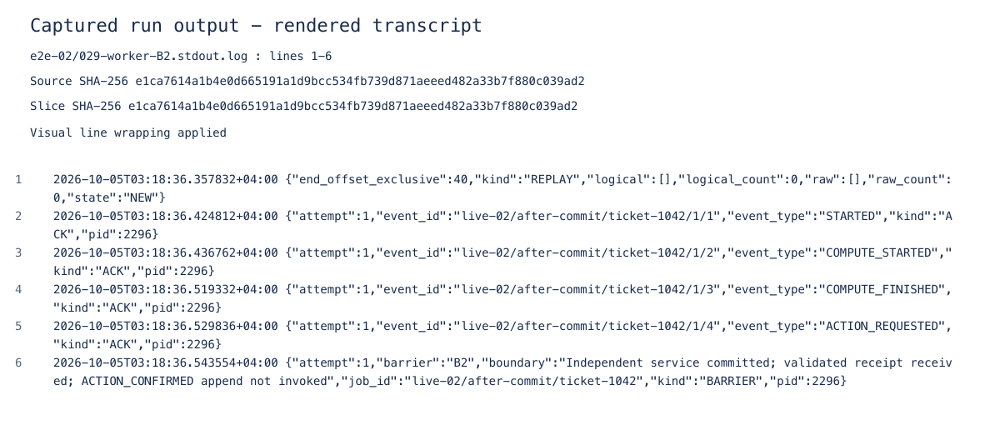

A support-ticket worker classifies a ticket, asks another service to create a follow-up task, and records its progress in an event log. Suppose it dies after the service creates the task but before it records the confirmation. After restart, the log still shows a pending request. Retrying could create a duplicate. Skipping could leave the ticket without a follow-up.

<!-- truncate -->

In this local Apache Fluss 1.0.0 lab, the worker is killed at three points: after classification returns, before the follow-up request leaves, and after the service creates the follow-up and acknowledges it. Recovery has to decide what to do with the history left behind.

The ticket and classifier are synthetic. A local HTTP service exposes `POST /compute`, which always returns `needs-followup`. It also creates follow-up records and stores computations, receipts and an HTTP audit in SQLite. There's no LLM inference or hosted provider here, so the experiment measures neither inference cost nor output quality.

## Where the worker records progress

Fluss holds the worker's persisted transitions. The HTTP service holds the actions it committed. Recovery reads both: an external action can finish after the worker's last log entry.



*Conceptual synthetic example. The worker reads Fluss event history and separately requests or looks up the HTTP service's SQLite-backed action receipt. The stores share no transaction; a deterministic classifier stands in for an LLM.*

The worker appends transitions to `retry_lab.job_events`, a Fluss Log Table. Recovery needs the rows from every attempt, including attempts that a later execution supersedes. An append-only table keeps that history. Fluss also provides Primary Key Tables for upserts and key lookups, with changelog reads available (see [table types](https://github.com/apache/fluss/blob/v1.0.0/website/docs/apis/index.md) and [primary-key changelog reads](https://github.com/apache/fluss/blob/v1.0.0/website/docs/engine-flink/reads.md)).

[](./assets/tracing-job-retries/architecture.svg)

*Conceptual diagram. The worker logs transitions in Fluss; the HTTP service stores follow-ups and receipts.*

The worker keeps these identities across execution and recovery:

| Field | What it identifies |
| --- | --- |
| `job_id` | The job, unchanged after restart |
| `attempt` | One worker execution attempt |
| `event_id` | One logical transition within an attempt |
| `action_id` | One intended follow-up, unchanged across attempts |

Within an attempt, `step` orders transitions and `event_type` names them. The remaining fields hold a display timestamp, a payload digest and `detail`. The clock determines neither identity nor ordering.

When the worker resends an event, it keeps the `event_id`. A new attempt gets new event IDs, but keeps the follow-up's `action_id`. Changing that action ID would ask the service to create another task for the same ticket.

The table has one bucket, and each job has one active worker. Fluss offsets identify positions within a bucket; offsets from different buckets don't define a table-wide order (see [ScanRecord](https://github.com/apache/fluss/blob/v1.0.0/fluss-client/src/main/java/org/apache/fluss/client/table/scanner/ScanRecord.java)). All offsets below belong to this single-bucket history. The experiment doesn't cover concurrent writers.

## The recorded lab environment

The captured run on 5 October 2026 GST used an isolated Linux amd64 container, Java 17.0.15, Maven 3.9.9 and the checksum-verified Fluss 1.0.0 binary distribution. The native [local-cluster script](https://github.com/apache/fluss/blob/v1.0.0/fluss-dist/src/main/resources/bin/local-cluster.sh) starts ZooKeeper, a coordinator and a tablet server. The worker connects directly through `org.apache.fluss:fluss-client:1.0.0`, without Flink, as described in the [Java client guide](https://github.com/apache/fluss/blob/v1.0.0/website/docs/apis/java/index.md). Initialization requires a fresh lab environment and table; it refuses an existing table.

The [runtime handoff](pathname:///labs/tracing-job-retries/evidence/RUNTIME_README.md) identifies the source and evidence from that run. The current standalone public setup and revised extraction procedure remain unverified. This command ran from `/lab/source` inside the historical container; it isn't a newly tested setup recipe:

```bash
python3 scripts/e2e.py verify --run-id live-02 --evidence /lab/evidence/e2e-02 --cluster-evidence /lab/evidence/native-runtime-02/cluster-runtime.json --bootstrap localhost:9123
```

The supervisor started the HTTP service, initialized the table, ran the cases and saved the evidence. Seven cases and 234 assertions passed for that source version. The [manifest](pathname:///labs/tracing-job-retries/evidence/e2e-02/manifest.json) records the run's boundaries.

## Persist intent before acting

The worker waits for Fluss to acknowledge its intent before calling the external service. If it called first, a crash could leave a committed effect with no intent in the log. This is the order in the compiled [FlussStore.java](pathname:///labs/tracing-job-retries/source/src/main/java/lab/retry/FlussStore.java):

```java
    void append(Event event) throws Exception {
        try (Table activeTable = table()) {
            AppendWriter writer = activeTable.newAppend().createWriter();
            CompletableFuture<AppendResult> appendFuture = writer.append(event.row());
            writer.flush();
            appendFuture.get(timeout, TimeUnit.SECONDS);
        }
        Json.emit("ACK", Map.of("event_id", event.event_id(), "event_type", event.event_type(),
                "attempt", event.attempt(), "pid", ProcessHandle.current().pid()));
    }
```

`Table` owns the closeable lifecycle. `AppendWriter.append` returns a future, and `flush()` waits for completion according to the acknowledgment configuration (see [TableWriter](https://github.com/apache/fluss/blob/v1.0.0/fluss-client/src/main/java/org/apache/fluss/client/table/writer/TableWriter.java) and [AppendWriter](https://github.com/apache/fluss/blob/v1.0.0/fluss-client/src/main/java/org/apache/fluss/client/table/writer/AppendWriter.java)). The timeout on `get` only bounds the future wait after the blocking flush. It doesn't bound the whole append.

## Read a complete history before deciding

Recovery can treat a missing event as absent only after reading the full relevant history. With writers stopped, it captures the client-visible latest offset, `H`, and scans `[0, H)`. The latest offset is the high watermark and an exclusive boundary (see [Replica offset methods](https://github.com/apache/fluss/blob/v1.0.0/fluss-server/src/main/java/org/apache/fluss/server/replica/Replica.java) and [LocalLog boundary](https://github.com/apache/fluss/blob/v1.0.0/fluss-server/src/main/java/org/apache/fluss/server/log/LocalLog.java)). The captured initialization probe appended records at offsets 0 and 1 and verified latest offsets 1 and 2. The scanner in the same source file stops when its exclusive progress reaches the captured end:

```java
        try (LogScanner scanner = activeTable.newScan().createLogScanner()) {
            scanner.subscribeFromBeginning(0);
            while (progress < end) {
                require(System.nanoTime() < deadline, "Bounded replay timed out before captured latest");
                ScanRecords batch = scanner.poll(Duration.ofMillis(250));
                collect(batch, records, end);
                progress = consumedProgress(batch, expectedBucket, progress, end, records.size());
            }
```

`consumedProgress` reads `ScanRecords.consumedUpToOffset`. The [ScanRecords](https://github.com/apache/fluss/blob/v1.0.0/fluss-client/src/main/java/org/apache/fluss/client/table/scanner/log/ScanRecords.java) contract allows an empty record batch to advance that position. The captured run verified the exclusive bounds, but did not observe an empty batch advancing progress. Replay also rejects a nonzero earliest offset or a missing raw prefix: a truncated history cannot establish that an action never happened.

## Failure A: classification finishes before its result is logged

To kill the worker at a known point, the supervisor waits for a named barrier reported by the worker. Barrier A sits after classification returns and before the `COMPUTE_FINISHED` append. The worker reported:

```json
{
  "attempt": 1,
  "barrier": "A",
  "boundary": "Independent compute completed; COMPUTE_FINISHED append not invoked",
  "job_id": "live-02/repeat-compute/ticket-1042",
  "kind": "BARRIER",
  "pid": 1604
}
```

The supervisor sent `SIGKILL`. PID 1604 exited with `-9`, while Fluss and the HTTP service kept running. A fresh recovery process, PID 1665, then started attempt 2.

For job `live-02/repeat-compute/ticket-1042`, the [pre-recovery trace](pathname:///labs/tracing-job-retries/evidence/e2e-02/repeat-compute-before-fluss.json) had `STARTED` at offset 8 and `COMPUTE_STARTED` at offset 9. The service ledger had one completed computation, but recovery couldn't find its result in Fluss.

Attempt 2 repeated classification. The [final trace](pathname:///labs/tracing-job-retries/evidence/e2e-02/repeat-compute-after-fluss.json) retained both attempts and ended with `COMPLETED` at offset 15. The [service ledger](pathname:///labs/tracing-job-retries/evidence/e2e-02/repeat-compute-after-ledger.json) had two computations and one follow-up. Those ledger records show that classification finished twice. Two `COMPUTE_STARTED` rows would only show that it started twice.

The crash happened before the append invocation. An append sent without a received acknowledgment is a separate, untested case. Repeating a real model call could also change the answer or incur another charge; the deterministic classifier fixes the answer so we can examine the recovery decision alone.

## Failures B1 and B2: the same intent, different service state

Before calling `POST /followups`, the worker appends `ACTION_REQUESTED` and waits for acknowledgment. The event's `detail` contains the complete canonical request: `job_id`, `classification`, `ticket_id` and `title`. It also carries the stable action ID and the SHA-256 of the payload bytes.

The worker needs the whole saved request to recover. A digest can detect a change, but can't reconstruct the bytes. Recovery reads and validates the request, then sends it unchanged. Reclassifying the ticket to rebuild that request could change its contents under the earlier action ID.

[](./assets/tracing-job-retries/crash-windows.svg)

*Conceptual diagram. Both workers stop before confirmation reaches Fluss; B2 has already received and validated the receipt.*

Both workers died with `ACTION_REQUESTED` as their last Fluss row. Only B2 had a committed follow-up:

| Captured boundary | Last Fluss offset for this job | Follow-ups before recovery | Follow-ups after recovery |
| --- | --- | --- | --- |
| B1: before `POST /followups` | 19 | 0 | 1 |
| B2: after receiving and validating the receipt, before `ACTION_CONFIRMED` | 43 | 1 | 1 |

The [comparison](pathname:///labs/tracing-job-retries/evidence/e2e-02/twin-normalization.json) normalizes job-derived IDs, timestamps and absolute offsets, then recomputes the normalized payload digest. It preserves event types, steps and request content. The two normalized pre-recovery traces were equal; the original [B1](pathname:///labs/tracing-job-retries/evidence/e2e-02/before-http-before-fluss.json) and [B2](pathname:///labs/tracing-job-retries/evidence/e2e-02/after-commit-before-fluss.json) records remain unchanged. A restarted worker reading only Fluss sees the same logical history in both cases.

B2 had received and validated the receipt, but lost that in-memory state when it died. Confirmation never reached Fluss. A lost response or network timeout remains untested.

### Ask the service what it committed

The follow-up service's [transaction](pathname:///labs/tracing-job-retries/source/scripts/service.py) creates a record under a unique action key and saves the receipt. Reusing the key and payload returns that receipt. Changing the payload under the same key returns HTTP 409. The duplicate and conflict checks left one effect.

On restart, the worker looks up the pending `action_id`. B1 received an explicit 404. For this service, the atomic idempotency contract means the key was never committed, so recovery posted the saved bytes and completed. You can't draw that conclusion from an arbitrary API's 404.

In B2, lookup returned the original receipt. Recovery checked its action ID and payload digest, then appended `RECONCILED`, `ACTION_CONFIRMED` and `COMPLETED` without another action POST. It rejected injected receipts with the wrong action ID or digest.

A separate fixture used an escaped, non-default title to catch recovery code that hard-coded the example request. The title survived in the persisted payload, raw HTTP payload bytes and stored effect, with zero classifier invocations. Five invalid-payload cases were rejected without an action POST.

### Hold the job when the receipt is unavailable

When lookup returned HTTP 503, attempt 2 recorded `HOLD_UNKNOWN` and made no new action POST. The worker left the job unresolved until the service could report what it committed. Once lookup was restored, attempt 3 reconciled the original receipt; the effect count stayed at one.

## What the application still has to provide

The application's reducer folds log rows into job state and handles repeated events. Fluss doesn't interpret `event_id`. Writing an event through two writer lifetimes produced rows at offsets 68 and 69 for the same logical transition. A third row reused the ID with conflicting content, and replay failed. All three raw rows stayed in the log.

The lab configured `client.writer.acks=all`, one replica and `table.log.ttl=0ms`, which disables time-based log deletion (see [Fluss configuration](https://github.com/apache/fluss/blob/v1.0.0/fluss-common/src/main/java/org/apache/fluss/config/ConfigOptions.java)). Those settings support a small, temporary experiment. Keeping every event indefinitely requires a storage plan.

Storage survived every worker kill in this serial experiment. The run doesn't establish recovery after host loss, safety with concurrent workers or exactly-once effects in another service. The external effect ends at the committed follow-up record. Sending an email after that commit would add another failure boundary.

## Reading the captured output



*Rendered transcript of captured run output, from [B2 worker stdout](pathname:///labs/tracing-job-retries/evidence/e2e-02/029-worker-B2.stdout.log), lines 1-6. Timestamps are GST (UTC+04:00). Long lines wrap for display; the linked bytes are unchanged.*

In B1 and B2, the same pending intent leads to different recovery actions once the worker checks the receipt. B1 creates the follow-up; B2 records the existing one. The earlier classification case repeats computation because its result is missing, while a failed receipt lookup leaves the job on hold. These decisions belong to the application. Before using them with another service, check whether its action-key and payload guarantees match those in `service.py`.
