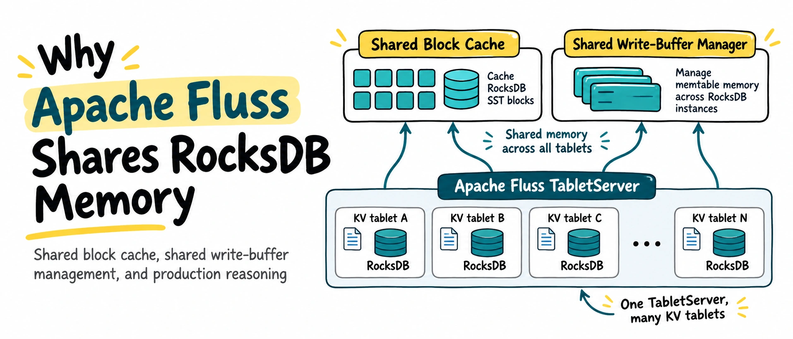
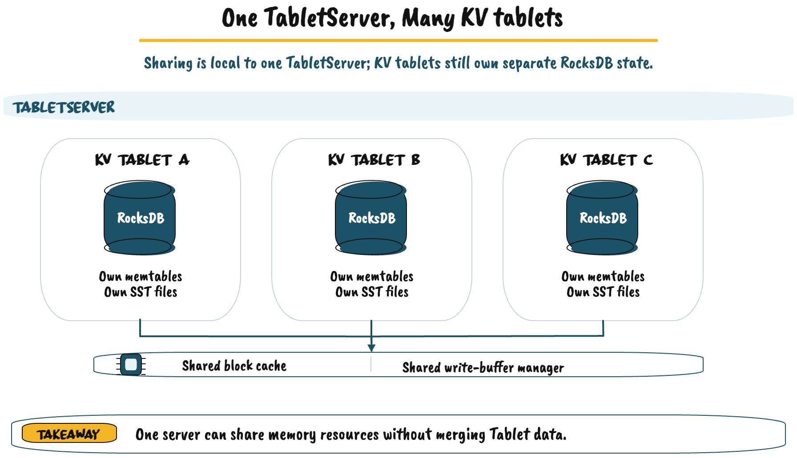
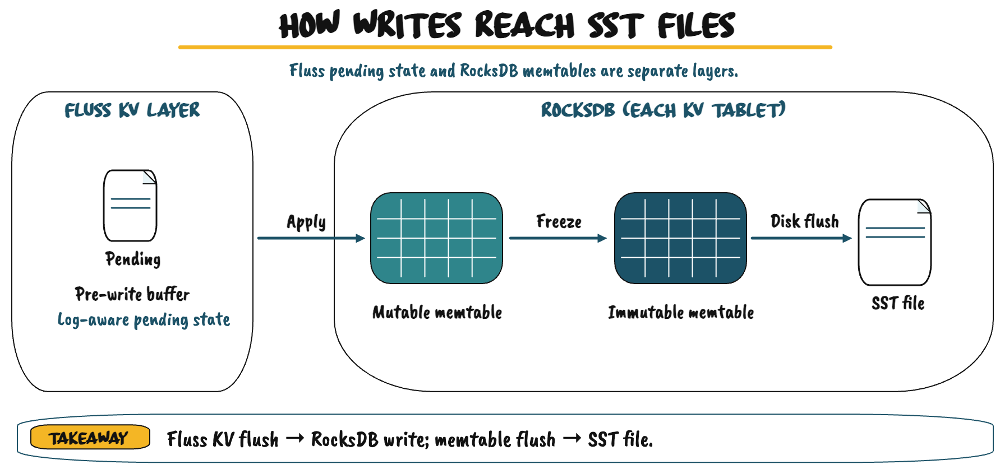
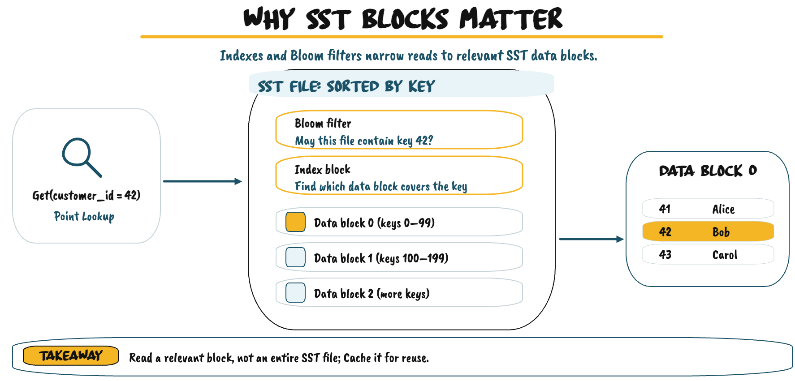
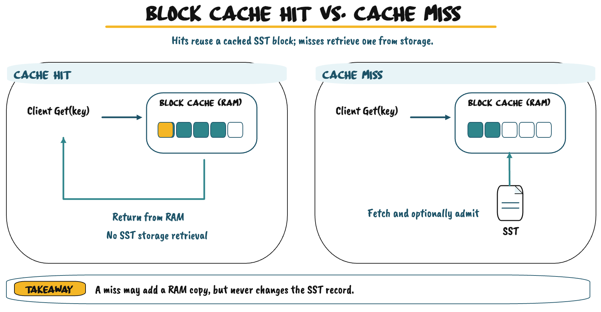
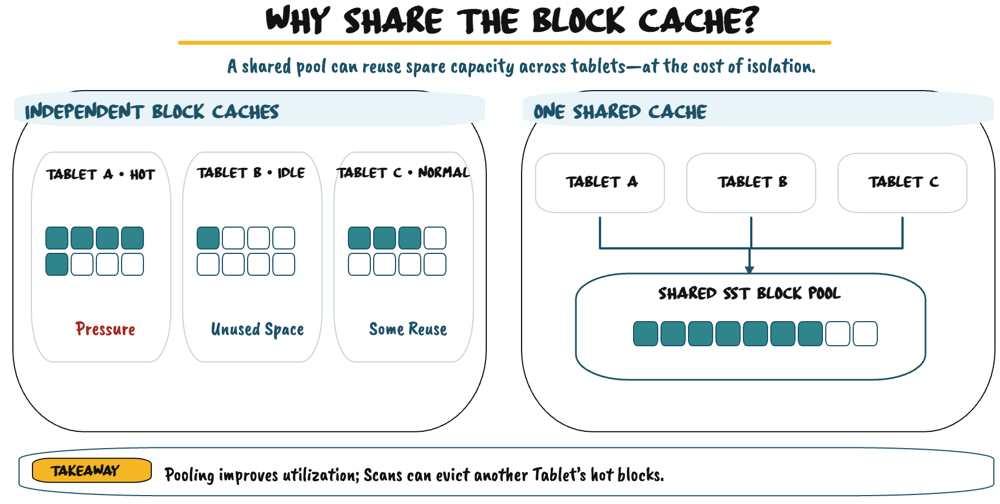
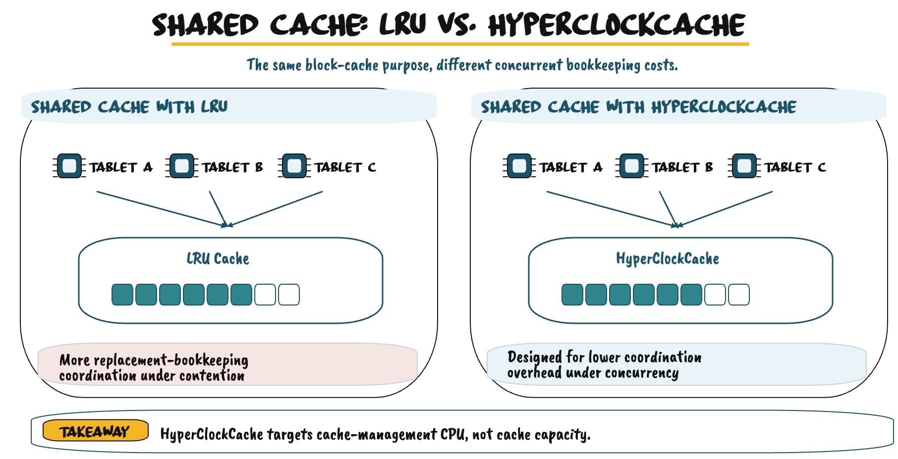
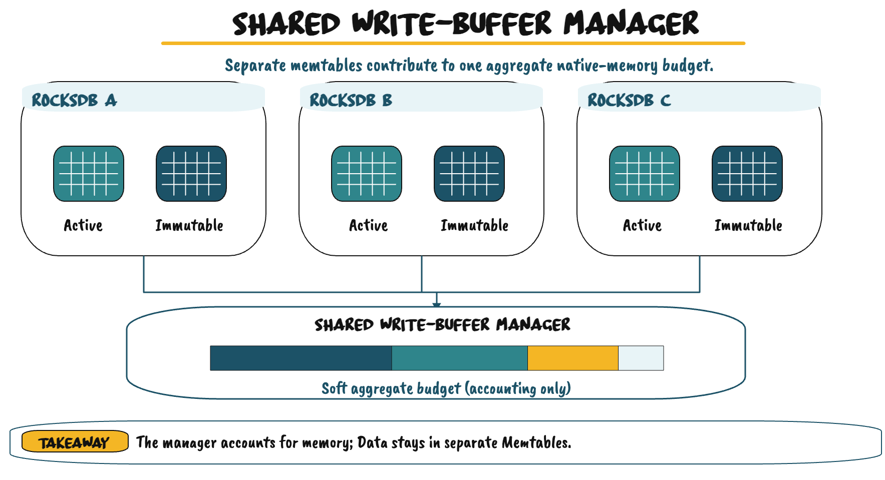
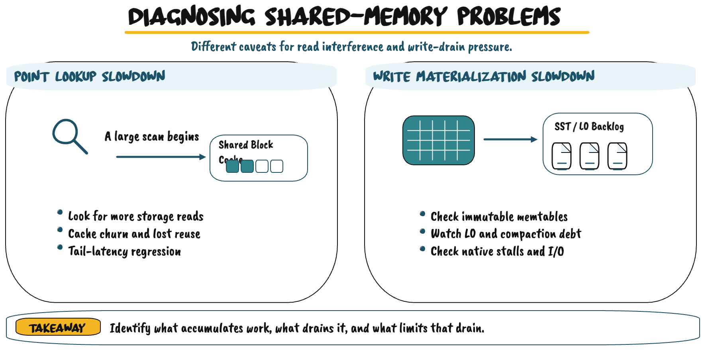

Understanding block caches, write-buffer management, and when shared memory becomes useful in production.

Apache Fluss does not require its users to become RocksDB specialists. For primary-key tables, RocksDB maintains local key-value state while Fluss handles ingestion, replication, and recovery. **The default configuration is a sensible starting point.** You do not need to enable shared memory simply to run Fluss.

Why, then, should we understand it? Because one TabletServer can host many independent RocksDB instances. As their workloads change, the way they use memory can influence read latency, write throughput, and the resources available to other tablets. Fluss offers two *optional* ways to manage that pressure: a **shared block cache** for reads and a **shared write-buffer manager** for memtables. The two solve different problems, and neither is a universal performance switch.

<!-- truncate -->

This article builds the necessary RocksDB mental models first, then explains what sharing changes, when it is worth enabling, and how to recognize the bottleneck before changing a setting. 
The goal is not to make Fluss more look more complicated to operate. 
It is to make its behavior easier to reason about when a production workload grows beyond the assumptions that worked initially.

## One TabletServer, Many Independent RocksDB Instances

A Fluss TabletServer hosts multiple **KV tablets**, each responsible for part of a primary-key table's local state. Every tablet has its own RocksDB instance, key space, memtables, and SST files. Those databases remain independent even though they run in one process and use resources from the same machine.

Fluss also maintains a **pre-write buffer** outside RocksDB. It tracks pending changes alongside their log positions and can help resolve recent values before those changes have been applied to the native database. This is not the same thing as a RocksDB memtable. Keeping the two separate is essential for understanding where write memory is consumed and which component controls it.



The sharing resource is **a single TabletServer**, not the entire Fluss cluster. Sharing cache space or memory accounting does not merge databases, their keys, or their on-disk files. It only changes how some of their local resources are managed.

## Why RocksDB Needs Memory for Writes

Suppose an application updates `customer_id = 42` from `tier = standard` to `tier = premium`. After Fluss processes the change through its log-aware pending-state path, it can apply the eligible update to RocksDB. RocksDB normally accepts it into an in-memory structure called a **memtable**.

A memtable lets RocksDB process new writes without modifying older sorted files each time a key changes. When the active memtable reaches its configured size, it becomes **immutable**: it can still be read, but it no longer accepts writes. A new memtable takes over while a background **memtable flush** turns the immutable one into a **Sorted String Table (SST) file** on local storage.



This introduces two different operations that are both called flushing. A **Fluss KV flush** applies eligible pending changes to RocksDB. A **RocksDB memtable flush** writes native in-memory state to an SST file. Later, **compaction** merges and rewrites SST files to control the number of versions and files RocksDB must examine during reads.

These stages matter because an actively writing tablet can have both mutable and immutable memtables resident in native memory. When many tablets write concurrently, their combined memtable consumption may be substantial. That is the problem a shared write-buffer manager is designed to help control, but first we need to understand the other major use of RocksDB memory.

The distinction between memtable flushing and compaction also matters under load. Flushes turn memory into new SST files, often at level zero (L0); individual SST files are sorted, but L0 files can have overlapping key ranges. Compaction then has to reorganize those files using CPU and storage bandwidth. A system can have enough memory to accept writes for a while and still slow down later if this background work accumulates. Memory provides temporary absorption, not unlimited throughput.

## Why RocksDB Needs Memory for Reads

An SST file is not simply a long list of independent records. It is organized into **data blocks**, each containing sorted key-value entries, along with metadata that makes individual lookups efficient. **Index blocks** help RocksDB locate the relevant data block. **Bloom filters**, when enabled, can rule out files that definitely do not contain a requested key. A Bloom filter cannot prove that the key exists; it only helps avoid unnecessary work.



When Fluss cannot resolve a lookup from its pending state, RocksDB checks the relevant memtables and then candidate SST files. Loading an SST block may involve storage I/O and decompression. If several requested keys live in the same block, reusing that block can make subsequent lookups cheaper.

A **block cache** is the portion of RAM RocksDB uses to retain useful SST blocks. Depending on configuration, it may hold data blocks as well as index or filter blocks. It does not store pending writes and is not an additional durable copy of the database. It simply avoids fetching the same stored blocks repeatedly.

It is worth distinguishing a block from a record: RocksDB generally retrieves and caches blocks that may contain multiple keys. The benefit therefore depends on locality—how often later queries need the same blocks—not just on the number of point lookups. Index and filter metadata can also consume memory outside the block cache, depending on configuration, so a block-cache size is not a complete measurement of the native memory used to serve reads.

A **cache hit** means the requested block is already in RAM. A **cache miss** means RocksDB must retrieve it through the SST storage path and may then keep a copy for future requests. Because cache capacity is finite, adding a block can evict another cached block; eviction removes only the memory copy, not the SST data on disk.



A nearly full cache is normal. The relevant question is **whether it retains blocks the workload will reuse**. Point lookups often revisit a relatively small working set, while broad scans may touch many blocks only once. That difference matters when multiple tablets share the same cache.

## Why Fluss Offers a Shared Block Cache

Imagine three tablets on one TabletServer. Tablet A serves frequent point lookups, tablet B has moderate activity, and tablet C is mostly idle. With separate caches, A can exhaust its own capacity even while C has unused cache space. The configured memory is divided among instances whether or not their demand is evenly distributed.

With a **shared block cache**, the three RocksDB instances draw from one pool of cached SST blocks. A busy tablet can make use of capacity that would otherwise remain reserved for an idle one. This is especially useful when a TabletServer hosts many tablets whose read activity varies over time.



Pooling also changes workload isolation. If tablet C suddenly performs a large scan, its newly loaded blocks may evict blocks repeatedly used by A. Point-lookup latency on A can rise even though A's query rate has not changed. Sharing can improve overall utilization while making cache interference between colocated tablets more visible.

Consider the difference between a scan that repeatedly visits a small data set and a scan that streams through gigabytes of blocks only once. The first may benefit from cache reuse; the second may mostly occupy space needed by other queries. The effect is workload-dependent, not an unavoidable flaw in shared caching. The useful experiment is to hold the point-lookup workload steady, vary scan activity, and observe whether SST reads and tail latency change together.

The right question is therefore not whether sharing is more efficient in the abstract. It is whether the shared pool **improves useful block reuse without violating the latency requirements of the workloads that share it**.

### HyperClockCache: Reducing the Cost of a Busy Shared Cache

Cache capacity is only one factor in read performance. A cache must also track accesses and decide which entries to evict. A conventional **least-recently-used (LRU)** policy involves maintaining recency information; under high concurrency, that bookkeeping can create synchronization overhead.

**HyperClockCache** targets the CPU cost of managing a shared cache accessed by many threads. It can reduce coordination overhead compared with a conventional LRU implementation, which is why it is useful for Fluss's TabletServer-wide shared cache.



HyperClockCache does not increase the available memory or guarantee a higher hit rate. A workload that repeatedly pulls cold blocks from disk can still suffer cache misses. When diagnosing slow lookups, separate **cache reuse** (are useful blocks being evicted?) from **CPU-side cache-access overhead** (is concurrency making access expensive?). Increasing cache capacity does not necessarily fix either problem.

That distinction changes the evidence to collect. Rising disk reads alongside lookup latency make ineffective reuse plausible. Higher CPU usage under growing reader concurrency, without a similar increase in disk reads, points toward a different bottleneck. Cache-management overhead is one possibility—not proof of the problem on its own. The observed workload should decide whether the cache implementation is delivering a benefit.

## Why Fluss Offers a Shared Write-Buffer Manager

The write side is different. Each RocksDB instance has its own memtables, and all write-active tablets contribute to the TabletServer's native-memory usage. A **shared write-buffer manager** tracks their aggregate memtable consumption against a common, **soft memory limit** and helps RocksDB respond to pressure through flushing.



The manager is **not a shared memtable**. Records stay in their individual RocksDB instances, and each instance continues managing its own mutable and immutable memtables. The manager does not allocate equal memory to every tablet or centrally select an ideal tablet to flush. Local memtable state and the ability of background work to make progress still matter.

The configured shared limit is also **soft**, not an instantaneous cap on process memory. When consumption increases, RocksDB can respond by flushing eligible memtables sooner. If that work completes, the pressure declines. If storage is too slow to complete the flushes - or compaction is already behind - native writes may ultimately slow or stall. Those outcomes depend on the state of the participating RocksDB instances, not solely on one server-level number.

There is an accounting detail worth keeping in mind. Shared write-buffer usage can represent memory already included in native memtable measurements. Even when a dedicated accounting cache is used internally, that does **not** mean a second copy of the key-value data exists. Adding these two measurements as separate allocations would overstate consumption.

During a short write burst, aggregate memtable usage may rise and then return to normal as memtables flush. Increasing the shared write-buffer size can provide more room for these bursts—assuming the TabletServer has sufficient headroom. But if flushing or compaction consistently falls behind, extra memory only delays the resulting write slowdowns. **More room to hold writes is not more capacity to process them.**

This is the distinction between the two features: the **shared block cache** helps reuse memory for *reads*, while the **shared write-buffer manager** helps coordinate memory consumed by writes. They are independent choices, not settings that should automatically be enabled together.

## When and How to Enable Shared Memory

Both features are **disabled by default** in Fluss. Without shared block caching, each RocksDB instance has its own cache; without a shared write-buffer manager, each manages its memtables without a TabletServer-wide shared limit. The configuration separates these choices:

| Configuration | Default | What it controls |
| --- | --- | --- |
| `kv.rocksdb.shared-block-cache.size` | `0b` | Shared SST block-cache capacity; `0b` disables sharing |
| `kv.rocksdb.shared-write-buffer.size` | `0b` | Soft shared memtable-memory limit; `0b` disables sharing |
| `kv.rocksdb.block.cache-size` | `8mb` | Per-instance cache capacity when sharing is disabled |
| `kv.rocksdb.writebuffer.size` | `64mb` | Per-instance memtable-size target, not the shared limit |

A shared block cache is worth evaluating when a TabletServer hosts many tablets with uneven lookup activity and the hot ones repeatedly fetch SST blocks while quieter tablets leave private cache space unused. If tablet working sets are predictable or strict tail-latency isolation matters, independent caches may already be a good choice.

Shared write-buffer management becomes more relevant when many tablets write concurrently and their combined memtable memory contributes significantly to pressure on the TabletServer. It is **not** a remedy for persistently saturated storage. The manager cannot make native flushes or compaction finish faster, and a shared limit that is too small may cause avoidable flushing.

To enable either feature, set a positive size in `conf/server.yaml`. For example:

```yaml
kv.rocksdb.shared-block-cache.size: 6gb
kv.rocksdb.shared-write-buffer.size: 4gb
```

These values belong to the **illustrative 24 GiB TabletServer example below**, not to a universal recommendation. With shared block caching enabled, the individual block-cache size setting no longer determines capacity for the participating instances. The per-instance memtable-size setting remains distinct from the shared write-buffer limit. Apply changes through a controlled TabletServer restart and verify the behavior of the Fluss release you deploy.

### Choosing Sizes Without Consuming All Available Memory

Start with the TabletServer's actual memory limit. Account for peak JVM and Fluss-managed state, native metadata and runtime overhead, then leave room for workload spikes and recovery. What remains can be considered for native memtables and block caching. **Available memory is not an obligation to use it all.**

For the **block cache**, estimate how much SST data is accessed repeatedly. Increase capacity only while the additional space meaningfully reduces storage reads or improves lookup latency. For the **write-buffer manager**, use measured aggregate memtable usage during periods when many tablets are writing at once, allowing room for legitimate short bursts. The total number of provisioned tablets alone tells you little about how many are simultaneously active.

For example, a RocksDB instance with a 64 MiB memtable target and two configured write buffers may temporarily hold both a mutable and an immutable memtable. Multiplying that possible per-instance footprint by every provisioned tablet, including idle ones, is not a realistic estimate of steady-state memory. Conversely, sizing only for the average tablet can miss the effect of hundreds becoming write-active together. Use concurrent workload measurements to test both extremes.

Consider this **illustrative memory allocation for a TabletServer limited to 24 GiB**:

| Memory consumer | Allocation |
| --- | ---: |
| JVM and Fluss-managed state | 6 GiB |
| RocksDB memtables | 4 GiB |
| Shared block cache | 6 GiB |
| Other native allocations and runtime overhead | 3 GiB |
| Unallocated headroom | 5 GiB |



These are planning assumptions, not hard process-memory caps or recommended defaults. If the shared block cache rises from 6 to 8 GiB, the planned headroom falls from 5 to 3 GiB. Increasing native write memory by another 2 GiB leaves only 1 GiB. Those changes may improve cache reuse or short-burst tolerance, but they also reduce the margin available when workloads spike. Be careful when comparing process RSS with host page-cache usage, because monitoring systems do not always report them as independent categories.

Roll out one shared mechanism at a time on a representative TabletServer. Measure a baseline, warm the workload, compare normal traffic alongside scans and write bursts, and keep clear rollback criteria. If the experiment targets a shared cache, include a scan that competes with point lookups, not just isolated reads. If it targets write-buffer memory, include both a short burst and a sustained write rate that exercises flush and compaction. An improvement in average memory utilization is not a production win if p99 latency deteriorates or recovery headroom disappears.

## Diagnosing Slow Reads and Slow Writes

The most useful production habit is to ask **what work is accumulating, what should complete it, and which resource is preventing progress**. This avoids treating every latency increase as a cache-size problem.

### Point Lookups Slow When a Scan Begins

Suppose tablet A maintains stable point-lookup latency until tablet C starts a broad scan on the same TabletServer. A plausible cause is **shared-cache churn**: the scan loads many blocks that displace A's hot blocks, increasing subsequent SST reads. Compare the timing of the scan with lookup latency and storage-read activity. A nearly full shared cache is not proof of trouble; a loss of useful reuse is.

If storage reads stay flat while CPU usage rises sharply, cache eviction becomes a weaker explanation. Look instead at CPU-side request work, concurrency, and scheduling, including the cost of accessing the shared cache. HyperClockCache targets one potential source of that overhead, but it cannot eliminate contention elsewhere in the read path. Test under representative scan concurrency rather than increasing the cache immediately.

### Writes Slow When More Tablets Become Active

Now imagine several tablets begin writing at once. Native memtable usage rises, Fluss takes longer to materialize pending updates, and RocksDB may begin slowing writes. The first question is whether this is **temporary write-memory pressure** or **a sustained background-processing bottleneck**.

A short burst can fill memtables faster than usual. If those memtables flush, their memory usage declines, L0 file growth remains controlled, and latency recovers, RocksDB is handling the additional work. Providing somewhat more shared write-buffer capacity may help with future bursts if memory headroom allows it.

The situation is different when new writes consistently generate more SST files than RocksDB can compact. L0 files and pending background work continue to grow; storage latency may rise and writes may eventually stall. Increasing the shared write-buffer size in this case only postpones pressure. Sustainable relief requires enough flush and compaction throughput to keep up with incoming work, reduced write pressure, or more effective storage capacity.

Follow the lifecycle rather than a long list of metrics. Does memtable usage fall when a burst ends? Are L0 files being compacted at a sustainable rate? Is the storage device already saturated, or is work queued while CPU and I/O capacity remain available? Answering those questions identifies the stage to address. Shared memory usage is measured at TabletServer scope, while some RocksDB indicators are per-bucket or aggregated differently; avoid drawing conclusions from numbers with incompatible scopes.

Change one setting at a time. Compare tail latency, throughput, storage I/O, CPU, memory headroom, and recovery behavior. Look for trends across the whole incident rather than one snapshot: a rising L0 count that eventually falls is different from a backlog that grows for hours. Similarly, a temporary jump in native memory with quick recovery is not the same as sustained pressure that keeps increasing. A change that improves peak throughput but leaves the TabletServer fragile during failover may not be a net improvement.

## A Simpler Rule for Production

Shared RocksDB memory is valuable because it lets independent tablets use a common resource more flexibly. But sharing brings tradeoffs. A shared block cache can reduce stranded memory while exposing hot lookups to a neighboring scan. A shared write-buffer manager can coordinate aggregate memtable usage, but it cannot create additional flush or compaction capacity. HyperClockCache can make concurrent cache access cheaper without changing those underlying limits.

**Start with the defaults.** If a workload shows inefficient cache reuse or genuine aggregate memtable pressure, test the relevant shared feature, measure the result, and keep enough room for other tablets and recovery. If latency is predictable and memory consumption is already stable, leaving the defaults unchanged is a sound engineering decision.

The best configuration is not the one with the largest cache or the most custom settings. **It is the simplest one that sustainably meets the workload's latency, throughput, and reliability requirements.**
