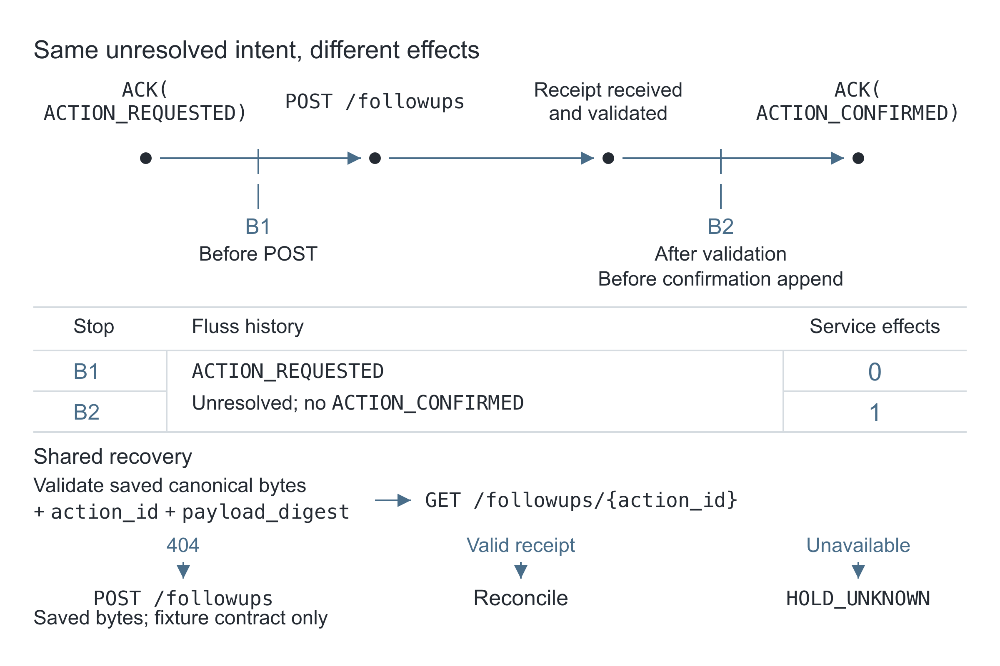

import crashWindowsUrl from '!file-loader?name=assets/files/[name]-[contenthash].[ext]!./assets/tracing-job-retries/crash-windows.svg';

In separate runs of the same serial worker, crashes occur at different points. B1 dies before sending a follow-up request. B2 dies after the service creates the follow-up and returns a receipt, but before the worker logs confirmation. A restarted worker sees the same logical Fluss history in both cases: `ACTION_REQUESTED`, with no `ACTION_CONFIRMED`.[^normalization]

The service ledger distinguishes the cases: B1 has no follow-up; B2 already has one. Recovery reads the intent from the log and must ask the service what it committed before deciding whether to retry.

<!-- truncate -->

The 20 October 2026 GST run used Apache Fluss 1.0.0 and a synthetic support-ticket worker. All seven core cases and all 344 assertions passed. B2's persisted prefix at the crash boundary was:

| Attempt | Step | Event | What recovery knows |
| --- | --- | --- | --- |
| 1 | 1 | `STARTED` | The worker began |
| 1 | 2 | `COMPUTE_STARTED` | Classification began |
| 1 | 3 | `COMPUTE_FINISHED` | The result is available |
| 1 | 4 | `ACTION_REQUESTED` | The complete follow-up request is saved; its external outcome is unresolved |

*These four events belong to `review-20261020-r8/after-commit/ticket-1042`. At B2, the worker had received HTTP 201 and validated its receipt, and the independent service ledger contained one durable follow-up row. The `ACTION_CONFIRMED` append had not been invoked.*

## Keep the history and the receipt separate

To process `ticket-1042`, the worker classifies it, asks an HTTP service to create a follow-up and appends transitions to `retry_lab.job_events`. The classifier always returns `needs-followup`; it is a deterministic fixture. The service records computations, effects, receipts and an HTTP audit in SQLite, independently of Fluss.

Fluss exposes two views of this history: a Log Table for replay and an event-ID Primary Key Table with one current row per event. Flink SQL reads both. Operators can inspect the retry trace and query the projection without building a separate trace store. The worker's recovery authority remains the append log; the projection does not decide whether an HTTP action happened. See the [Fluss table model](https://fluss.apache.org/docs/table-design/overview/).

Fluss can keep a hot log for fresh recovery and replay, use a PK projection for lookups, and tier history to a lakehouse for longer-term queries. Remote log tiering keeps log segments in Fluss's native format; lakehouse tiering writes an open table format through a configured, running tiering service.

| Identity | Lifetime |
| --- | --- |
| `job_id` | Stable across restarts |
| `attempt` | One worker execution |
| `event_id` | One transition, identified by job/attempt/step |
| `action_id` | One intended follow-up, stable across attempts |

Attempt/step order the transitions; timestamps are for display. Repeated events keep their event ID; a new attempt gets new event IDs while keeping the action ID. The SQL schema includes all nine event fields.

This implementation is serial: one active worker, one shared log bucket and replay from offset 0. All writers to that bucket must be stopped during a bounded recovery read. Offsets order records within a bucket, not across the whole table.

## Three crash windows

[](./assets/tracing-job-retries/crash-windows.svg)

<p><a href={crashWindowsUrl} target="_self">Open the full-size diagram</a></p>

**A: computation finished, result not logged.** The service has committed a classification result, but the worker has not invoked the `COMPUTE_FINISHED` append. Recovery finds `STARTED` and `COMPUTE_STARTED`, then repeats classification. The independent ledger recorded two completed computations and one follow-up. Two start events alone would not prove that computation finished twice.

**B1: intent logged, HTTP not invoked.** `ACTION_REQUESTED` has been flushed and acknowledged. The service has no follow-up. Recovery validates the saved payload, looks up the stable action ID and receives an explicit negative receipt under the fixture's atomic contract. It then POSTs that same action ID and payload.

**B2: successful response and validated receipt, confirmation append not invoked.** The worker has received HTTP 201 and validated the receipt, and the service has one durable follow-up row. The barrier is after receipt validation and before invocation of the `ACTION_CONFIRMED` append. The restarted worker sees the same pending-intent prefix as B1. Lookup returns the original receipt. Recovery validates its action ID and payload digest, then appends `RECONCILED`, `ACTION_CONFIRMED` and `COMPLETED` without a second action POST.

| Crash boundary | Effects before recovery | Effects after recovery | Recovery action |
| --- | --- | --- | --- |
| B1 | 0 | 1 | Look up absence, then send saved request |
| B2 | 1 | 1 | Look up original receipt, record confirmation |

The supervisor waits for an explicit barrier, sends `SIGKILL`, verifies process death and starts a fresh JVM. Fluss and the SQLite service keep running.

## Save intent before calling the service

`ACTION_REQUESTED` contains the complete canonical request bytes in `detail`, plus their SHA-256 digest. The request contains job ID, classification, ticket ID and title. Recovery validates the saved bytes and sends them unchanged. A digest detects changes; it cannot reconstruct the request. Reclassifying the ticket to regenerate a payload could bind different content to the old action ID.

The Java client keeps one connection and one thread-confined `Table` and append writer for the store's lifetime, following the [Java client resource model](https://fluss.apache.org/docs/apis/java/). Opening is lazy so initialization can create the table first. It validates metadata on open, then uses this append path:

```java
    void append(Event event) throws Exception {
        Table table = table();
        if (writer == null) {
            writer = table.newAppend().createWriter();
            Json.emit("WRITER_OPEN", Map.of("store_lifetime", lifetime));
        }
        CompletableFuture<AppendResult> appendFuture = writer.append(event.row());
        writer.flush();
        appendFuture.get(timeout, TimeUnit.SECONDS);
        Json.emit("ACK", Map.of("event_id", event.event_id(), "event_type", event.event_type(),
                "attempt", event.attempt(), "pid", ProcessHandle.current().pid(), "store_lifetime", lifetime));
    }
```

The application emits its ACK/barrier only after flush returns and the append future succeeds. The timeout bounds `future.get()` after blocking flush, not the whole append. The store closes its table, admin and connection at the end of its lifetime. The [1.0.0 writer API](https://github.com/apache/fluss/blob/v1.0.0/fluss-client/src/main/java/org/apache/fluss/client/table/writer/TableWriter.java) exposes `flush()` but no `close()`; the lab README describes cleanup after failures.

## Read the whole prefix before deciding

With writers stopped, recovery captures the committed-log high watermark `H` and reads `[0, H)`. Fluss readers consume committed records up to that watermark; see the [architecture guide](https://fluss.apache.org/docs/concepts/architecture/).

The scanner finishes when its exclusive consumed position reaches `H`. `ScanRecords.consumedUpToOffset` can advance even when a poll contains no rows, so an empty poll is neither completion nor proof of absence. The [1.0.0 client Javadoc](https://github.com/apache/fluss/blob/v1.0.0/fluss-client/src/main/java/org/apache/fluss/client/table/scanner/log/ScanRecords.java) defines that position.

Recovery aborts if it detects a missing prefix, changed table metadata or a changed committed-log end. These checks do not detect writer presence or enforce exclusion; all writers to the bucket must remain stopped throughout the read. The lab README gives the initialization probes, offset checks and metadata checks.

## A 404 needs a contract

The fixture commits the effect and receipt in one SQLite transaction, keyed by action ID and bound to the exact payload. Repeating that key and payload returns the original receipt. Changing the payload returns HTTP 409. Receipt lookup is authoritative within this fixture, requests are serialized and receipts do not expire.

An arbitrary API's 404 establishes none of those properties. It may hide an authentication or authorization failure, reflect an eventually consistent index, refer to an expired receipt or arrive while an earlier request is still in flight. Before treating absence as permission to POST, establish the authenticated lookup semantics, idempotency scope and retention window, payload binding, and how the service handles in-flight requests.

Reuse the original stable action ID and immutable saved payload. A fresh key asks for a new action. If transport, authentication, retention or lookup semantics leave the outcome uncertain, record `HOLD_UNKNOWN` and stop. Neither a Fluss acknowledgment nor a PK row can settle that uncertainty.

In the recorded run, HTTP 503, an ordinary undocumented 404, HTTP 401 and an unknown receipt contract each produced `HOLD_UNKNOWN` without another action POST. Once authoritative lookup was restored, recovery reconciled the original receipt. Malformed positive receipts with a wrong action ID or digest were rejected without another action POST.

## Query traces and project events with Flink SQL

Flink can read a Fluss Log Table in bounded batch mode. This query selects the recorded B2 job:

```sql
SET 'execution.runtime-mode' = 'batch';
SET 'sql-client.execution.result-mode' = 'tableau';
CREATE CATALOG fluss_catalog WITH (
    'type' = 'fluss',
    'bootstrap.servers' = 'coordinator-server:9123'
);
SELECT attempt, step, event_type, action_id
FROM fluss_catalog.retry_lab.job_events
WHERE job_id = 'review-20261020-r8/after-commit/ticket-1042'
ORDER BY attempt, step;
```

The ordered output matched an independent fresh Java read of the same run. The runner substitutes the selected run's real job ID when reproducing the query. See [Flink reads](https://fluss.apache.org/docs/engine-flink/reads/) and the [Flink quickstart](https://fluss.apache.org/docs/quickstart/flink/).

The companion table uses the same nine fields for keyed queries:

```sql
CREATE TABLE fluss_catalog.retry_lab.events_by_id (
    job_id STRING,
    event_id STRING NOT NULL,
    attempt INT,
    step INT,
    event_type STRING,
    action_id STRING,
    payload_digest STRING,
    emitted_at_ms BIGINT,
    detail STRING,
    PRIMARY KEY (event_id) NOT ENFORCED
) WITH (
    'bucket.num' = '1',
    'table.log.ttl' = '0ms',
    'table.replication.factor' = '1'
);
```

A bounded `INSERT INTO ... SELECT ...` imports reducer-validated records from the actual log after the serial run. Identical event IDs produce one current PK row. Conflicting reuse of an event ID must fail reducer validation before import; an upsert could otherwise overwrite the evidence of that conflict. The lab README describes the repeated-import and all-field comparisons.

The recorded imports selected the completed B2 job and a distinct-writer duplicate case. Two identical imports each left nine current rows, with all nine fields of every row matching the fresh Java read. The duplicate case contributed two identical raw log records and one current PK row.

A new bounded job on a fresh TaskManager JVM also returned all nine rows, with all nine fields matching the Java result. Its assigned split used table 4, bucket 0, snapshot 1 and an empty log interval `[31, 31)`, ending at the stopped PK end offset 31. Snapshot metadata identified five files, including two SST files; the same job's logs recorded the matching bucket's snapshot download and split completion. In the [pinned scanner](https://github.com/apache/fluss/blob/5c07f88e50a8ff41b0ebc214a0458e5dba60be37/fluss-client/src/main/java/org/apache/fluss/client/table/scanner/batch/KvSnapshotAndLogBatchScanner.java), that empty interval disables log replay; the [snapshot reader](https://github.com/apache/fluss/blob/5c07f88e50a8ff41b0ebc214a0458e5dba60be37/fluss-client/src/main/java/org/apache/fluss/client/table/scanner/batch/SnapshotFilesReader.java) reads the downloaded RocksDB snapshot. Together, these provide a source-backed witness of snapshot consumption.

The PK projection gives one current row per event ID. Its changelog can still contain repeated writes. It provides neither a cross-table transaction nor worker ownership, and this worker continues to recover from the log.

## Reproduce the experiment

The [author-owned lab](https://github.com/tridev-tej/fluss-crash-safe-retries/tree/54aaff5d69708573092eca377e0021f65aab813d) includes the worker, independent fixture, seven E2E cases and a `docker compose` quickstart. Its core command kills real JVMs and compares Fluss reads with the independent SQLite ledger. Use the separate SQL profile for the trace query and repeated projection import.

The full SQL check passed all nine assertions, covering output equality and the stored-snapshot read. A separate negative check confirmed that an invalid trailing SQL statement is rejected even when the pinned client exits zero. The recorded host was Linux x86_64. The README gives the Docker/Compose prerequisites, reproduction commands and detailed snapshot-proof contract.

## Limitations

This experiment covers worker-process death with the cluster and fixture running. It does not establish host-loss survival, cluster failover or general exactly-once external effects. One replica and minimum ISR 1 mean `acks=all` adds no follower redundancy over leader acknowledgment. That setting is not proof of host durability. B2 occurs after a successful response and validated receipt; response loss, timeouts and requests still in flight are separate experiments. The effect ends at the committed follow-up record; sending an email afterward adds another boundary.

The snapshot witness is not a syscall trace, proof that every snapshot file was opened, or proof of a cold OS cache. No lakehouse experiment ran.

The current one-bucket implementation scans the full prefix and requires all writers stopped. Scaling across jobs would use multiple buckets hashed by job ID, one fenced or leased owner per job, per-bucket checkpoints and a recoverable per-job PK current-state projection. Hashing adds concurrency across jobs, not within one job. A projection cannot be assumed to commit atomically with an external effect.

`table.log.ttl=0ms` only disables TTL deletion. Lakehouse analytics does not silently replace this worker's native offset-0 replay. A production retention design must keep its recovery history/state available before deleting the hot prefix. See the [lakehouse overview](https://fluss.apache.org/docs/streaming-lakehouse/overview/).

[^normalization]: The comparison validates actual request bytes and digests first, then normalizes job-derived IDs, display timestamps and absolute offsets, including the embedded job ID and its derived digest. Event types, attempt/step order, bucket and remaining request content are preserved. The raw traces are not byte-identical. The lab README describes the full method.
